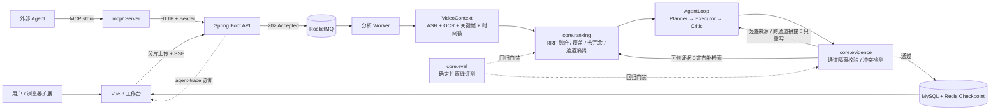
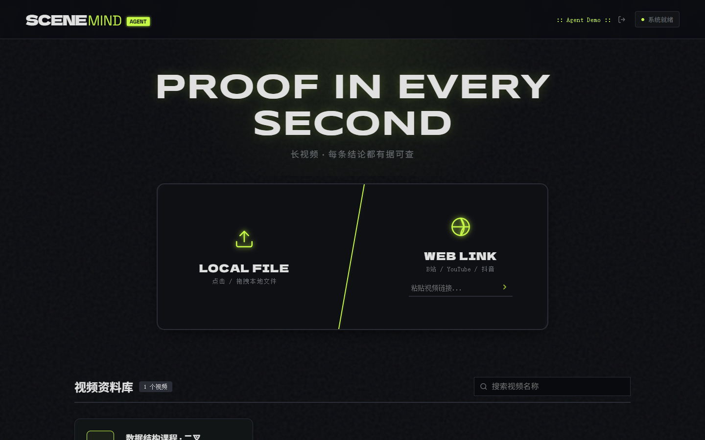
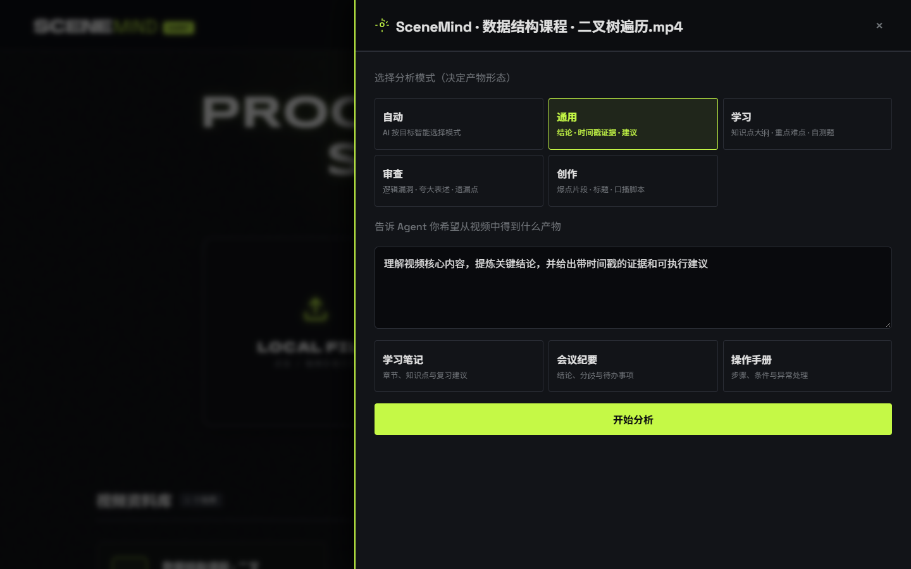
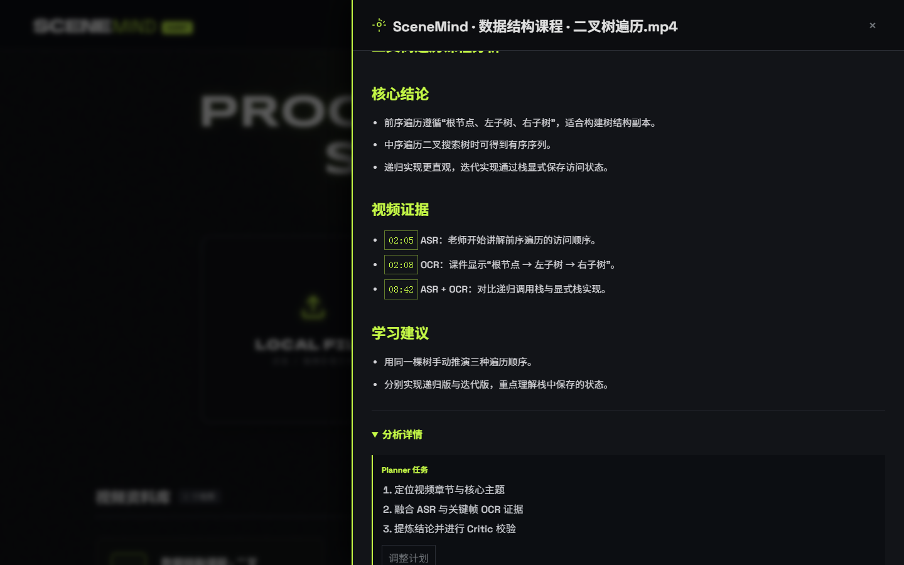
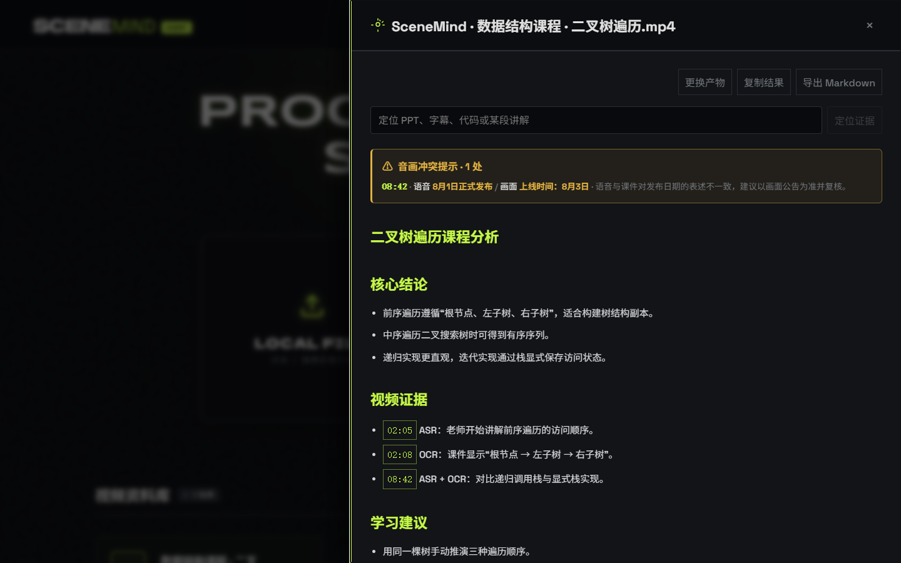

# SceneMind

> 面向长视频的**证据可核验** Video Agent 工作台。
> 把数小时的视频变成一条可检索、可回放、每条结论都能定位到原始时间戳的多模态证据链。

长视频理解和「把视频丢给模型总结一下」是两件不同的事：上传和分析都是分钟级任务，模型调用按 Token 计费，而最麻烦的是——模型很会编。SceneMind 围绕这三件事设计：把耗时链路异步化、把语音与画面融合成带时间戳的统一上下文、再用一层确定的校验规则约束模型输出。

---

## 它解决什么问题

| 难点 | SceneMind 的处理 |
| --- | --- |
| 大文件上传与解析都是长耗时任务 | 5MB 分片 + 断点续传，RocketMQ 削峰，提交即返回 202；Checkpoint 以 MySQL 为真源、Redis 为热缓存 |
| 外部调用贵且不稳定 | 用户级/全局令牌桶、有限次指数退避、向量库与 Embedding 故障优雅降级、AgentLoop 轮次上限 |
| 结论找不到依据 = 幻觉 | 每条结论必须绑定 `ASR` / `OCR` / `ASR+OCR` 来源与时间戳，由 Critic 闭环校验，不过关就定向补检索 |
| 证据散落在数小时里 | 时序多模态 `VideoContext` + 混合检索；**SceneMind 用 RRF 多通道融合替代线性加权**，解决跨时段覆盖与近重复问题 |

---

## 能力边界

一个项目值不值得聊，边界比功能列表更重要。SceneMind 明确**不**做：

- 不自研 ASR / OCR / Embedding 模型，全部通过可替换的外部服务接入；
- 不做模型训练与微调，Agent 的质量靠**检索策略 + 证据约束 + 离线评测**保障；
- 不做多租户、计费、公网级鉴权，部署目标是本地 / 单机可信环境；
- 不承诺「任意视频都能得到正确答案」：画面与语音冲突时会**显式标注冲突**，而不是替用户猜。

基础设施层（上传、消息队列、存储、鉴权、工作台）沿用一套成熟的 Java/Vue 实现；**SceneMind 的设计与实现集中在检索排序、证据校验和评测闭环这三块**，详见 `docs/PROJECT_OVERVIEW.md` 与 `docs/CONTRIBUTION_BOUNDARY.md`。

---

## 我主导的改造

### 1. 检索排序：从线性加权到 RRF 多通道融合

改造前把三个通道的原始分直接加权相加：`0.6 * semantic + 0.25 * lexical + 0.15 * visual`。问题很具体——`semantic` 可能是 Qdrant 返回的 `[0,1]` 分数，也可能是本地 cosine 的 `[-1,1]`，而 `lexical` / `visual` 是 `[0,1]` 的命中率。量纲不一致时，权重就不再代表真实重要性，换一家向量服务就能让排序悄悄漂掉。

我把排序层从 Spring Service 里抽出来，做成 `com.scenemind.core.ranking` 纯函数内核：

- 三个通道各自产出**有序列表**，融合只使用名次：`score(d) = Σ w_c / (k + rank_c(d))`（RRF）。原始分数永不进入同一个加法式，天然免疫量纲差异；
- **通道隔离**：每个通道只接收确实声明了该通道证据的候选（`channelsPresent`）。此前内核与适配层都把同一份全量候选交给三个通道，导致没有 OCR 的片段照样从视觉通道借到名次、`matchedChannels` 恒为 3，`TopKPolicy` 的「弱证据扩召回」分支永远不可达；现在内核与适配层都按通道过滤，`HybridRankerTest` 覆盖了这条路径；
- 第一轮每个 5 分钟时间窗只取最优证据，避免数小时视频的 TopK 全挤在同一段；名额不足再按融合分补满；
- 时间相邻且文本 bigram 相似度超阈值的片段判为近重复并抑制；
- `TopKPolicy` 根据通道命中数和分数分布动态决定召回预算，弱证据扩召回、头部强主导时收缩省 Token；
- 每次检索输出**可解释诊断**：各通道名次、选中阶段、抑制数量、覆盖时间窗数，并经 `/analysis/agent-trace` 的 `diagnostics.retrieval` 落到前端调试面板。

参数全部收敛到 `scenemind.ranking.*` 配置项，A/B 调参不需要改代码发版。

### 2. 证据校验：从 boolean 到可解释的判定

改造前的 `supported()` 只返回 true/false，线上出现「Critic 反复重检索但始终不通过」时，无法区分是时间戳越界、模型改写了原文，还是编造了来源——所有失败都无差别重跑两轮，白烧 Token。

新的 `EvidenceAuditor`：

- 拒绝原因枚举化（`TIMESTAMP_OUT_OF_RANGE` / `CROSS_CHANNEL_SPLICE` / `UNKNOWN_SOURCE` …），并标注 `retryable`，让 Agent 知道该回去补检索还是直接判定幻觉；
- **通道隔离**：声明 `ASR+OCR` 时分别检查两条通道，要求证据在同一通道内完整出现。改造前把 ASR 与 OCR 文本直接拼接，模型从语音尾巴 + 画面开头拼出一句原文里不存在的话也会被当成有效证据；
- 拒绝时仍返回文本二元组覆盖率，用于区分「改写」和「编造」；
- `ConflictDetector` 显式识别音画冲突（口播「八月一日上线」/ PPT「8月3日」），把不确定性作为一等信号输出。

这些能力没有停在纯函数里。`EvidenceVerificationService.auditResult()` 把 9 类拒绝原因、`retryable` 标记与音画冲突聚合成一次任务的核验报告，并接进 `AgentLoopService` 的 Critic 环节：

- **可修证据按时间戳定向补检索**：时间戳越界、通道为空、原文找不到这类证据缺口，收集时间戳交给 Critic 补检索；
- **伪造来源 / 跨通道拼接直接判幻觉**：不进补检索名单，只按反馈重写，省掉一轮白烧的检索；一轮里只剩这类拒绝时走「只重写」路径；
- 分流逻辑抽成纯函数 `EvidenceRetryPolicy`（`NONE` / `REFRESH_EVIDENCE` / `REWRITE_ONLY`），零框架依赖、可单独单测，决策同时写入 trace 的 `diagnostics.retry`。

音画冲突也进了结果链路，而不只是一个布尔埋点：`TaskStatus` 带结构化 `conflicts` 字段，结果 markdown 顶部有「音画冲突提示」警示条，SSE 完成事件与重新打开面板（`analysis-status` 恢复历史结果）都会带上；前端渲染冲突警示条，并在「分析详情」里展示证据核验（采纳数 / 可重试驳回 / 疑似幻觉）。

原有三个 public 方法语义完全不变，既有的 4 个回归测试无需修改即可通过。

### 3. 离线评测：可被 CI 卡住的确定性回放

**新增**了 `core.eval` 确定性评测路径；旧的 `OfflineAgentEvaluationRunner` 仍保留在仓库里，它依旧会调用真实 LLM（需要 API Key、结果不可复现），由 `agent.evaluation.enabled=false` 默认关闭，只作为在线评估入口存在，不参与 CI。

新路径把「检索策略」单独抽出来做确定性回放：固定合成数据集 + 固定算法，不启动 Spring、不连数据库/向量库、不调用任何模型，`javac` + `java` 就能跑。两个关键设计：

- **与线上同链路**：评测走 `fuse() → TopKPolicy.decide() → select()`，与 `VideoEvidenceRetrievalService` 一致；参数从与 Spring 同名的 `SCENEMIND_*` 环境变量读取（`SCENEMIND_RRF_K`、`SCENEMIND_MAX_RESULTS`、三个通道权重等），改配置会同时改变线上排序与离线报告；
- **报告可审计**：`docs/benchmark-report.md` 新增「生效策略配置」小节，列出本次实际生效的参数。CI 校验提交的报告与 CI 生成结果字节一致，所以改配置却不更新报告同样会卡住 PR。

自检断言从 8 条增加到 **11 条**：原有 8 条覆盖相对基线不退化、RRF 稳定性、证据回归、冲突检测与 TopK 决策，新增的 3 条是绝对阈值——Recall ≥ 0.75、时间覆盖率 ≥ 0.75、冗余率 ≤ 0.20，避免「相对基线没退步、但绝对值已经很差」悄悄通过。

### 4. 工程化收口

包名从占位符 `com.example` 规范为 `com.scenemind`；新增 `core` 纯函数层及其单测；CI 拆出独立的零依赖评测 job；评测脚本跨平台可复现（用 bash 的 globstar 收集源文件，不再依赖在 Windows 上语义完全不同的 `find`）。

文档方面：`docs/` 下补齐项目说明、贡献边界、扩展面板设计、评测报告与 2 份 ADR；简历与面试话题移到 `docs/private/`，该目录已在 `.gitignore` 中忽略，不随公开仓库发布。

### 5. MCP Server：把证据结果交给别的 Agent

新增 `mcp/`：零外部依赖的 MCP Server（只用 Node.js 内置模块，stdio JSON-RPC 2.0，不需要 `npm install`）。外部 Agent 把视频链接与分析目标交给它，它调用 SceneMind 后端，把带**时间戳 / 来源 / 原文**的结构化证据返回给对方 Agent，而不是一段无法核验的摘要。

协议取舍、工具清单与错误语义见 `docs/MCP_SERVER.md`，本地接入方式见 `mcp/README.md`。当前只做 stdio；远程部署（Streamable HTTP + 鉴权）在路线图里。

---

## 量化结果

`docs/benchmark-report.md` 由评测程序自动生成，可直接 `bash scripts/run-benchmark.sh` 复现。
数据集是**可复现的合成压力数据集**（2 小时课程 / 28 个候选片段 / 4 个标注相关片段），用于策略回归，**不是线上真实流量**：

| 指标 | 线性加权（改造前） | RRF 融合（改造后） |
| --- | ---: | ---: |
| Recall@8 | 1.000 | 1.000 |
| 时间覆盖率 | 1.000 | 1.000 |
| 证据冗余率 ↓ | 0.143 | **0.000** |
| 量纲稳定性 ↑ | 0.500 | **1.000** |

> 量纲稳定性 = 把语义分数做 `37x + 5` 的单调变换（模拟向量服务打分尺度变化）后 TopK 集合的 Jaccard。RRF 只用名次，恒为 1.000；线性加权会因权重失衡漂移一半结果。
> Recall 与覆盖率在这份数据集上持平——相关片段信号较强，改造解决的是**冗余与鲁棒性**，不是召回上限。要验证召回收益需要真实标注集，这是路线图里的下一步。

测试：`server` 24 个测试类、74 个 `@Test` 用例，`bash ./mvnw test` 实测 0 失败；其中 `core` 纯函数层 5 个测试类 29 个用例，本轮证据回环与 trace 契约新增 4 个测试类（`EvidenceRetryPolicyTest`、`EvidenceAuditIntegrationTest`、`AgentTelemetryTest`、`RealAnnotationEvaluationTest`；真实标注集用例在未放数据时自动跳过）。`client` 的既有前端用例保持通过（`cd client && npm test`）；`extension` 的用例需先 `npm ci`；`mcp/` 的用例用 `node --test` 跑，不依赖后端。

---

## 架构



`core` 三个包不依赖 Spring、数据库或网络，可单独编译运行；`server` 只做 DTO 适配、外部依赖降级与埋点。

---

## 界面

工作台视频列表：分片上传后按任务卡片管理「下载音频 / 提取文字 / AI 智能总结」。



> 截图来自内置示例数据（`?demo`），不是真实用户数据；分辨率 1440×900。

提交分析目标：可以直接写需求，也可以用「生成学习笔记 / 提炼会议结论 / 梳理操作步骤」预设。



结果面板：每条结论都绑定 `[mm:ss]` 时间戳与 `ASR` / `OCR` 来源，点击时间戳可回放原视频。



> 以上截图来自内置示例数据（`?demo`），不是真实用户数据。

---

## 快速开始

> 想直接在云服务器上跑一个公网实例？见 [docs/DEPLOY.md](docs/DEPLOY.md)：Docker Compose 一键起全栈，Caddy 自动 HTTPS。

### 前置条件

| 目标 | 需要 |
| --- | --- |
| 零依赖演示（`?demo`） | Node.js 22 |
| 只复现离线评测 | JDK 21 |
| 完整端到端演示 | 上面两项 + Docker Compose v2、FFmpeg、Tesseract（含 `chi_sim` + `eng` 语言包）、真实 `SILICONFLOW_API_KEY`、可用的 bash |

> **Windows 请用 Git Bash 或 WSL。** `scripts/*.sh` 是 bash 脚本，PowerShell / CMD 不能直接执行。
> 本文统一写成 `bash scripts/...`、`bash ./mvnw ...`，而不是 `./scripts/...`、`./mvnw ...`：不依赖文件的可执行位。仓库历史版本里这些脚本以 644 权限提交，直接 `./scripts/dev-up.sh` 在 Linux/macOS 上会 `Permission denied`；用 `bash` 显式调用不受影响，Windows 上 `core.fileMode` 不保留权限位时同样能跑。

### 0. 唯一零依赖路径：`?demo`

**在线演示（无需安装任何东西）：<https://erfan817.github.io/SceneMind/?demo>**



不需要后端、数据库、Docker 或 API Key。想在本地跑同样的页面：

```bash
cd client
npm ci
npm run dev
```

打开 <http://localhost:5173/?demo>，工作台会用内置示例数据渲染完整面板（检索诊断、证据核验、音画冲突提示都能看到）。这是**唯一**不需要任何中间件与外部服务的演示路径，其余章节都要先起后端。

### 1. 完整端到端演示

**必填的 5 个环境变量**（`server/src/main/resources/application.properties` 里这几项没有默认值，缺任意一个后端都起不来）：

| 变量 | 用途 |
| --- | --- |
| `DB_USERNAME` | MySQL 应用账号，需与 `MYSQL_APP_USER` 一致 |
| `DB_PASSWORD` | 该账号密码 |
| `SILICONFLOW_API_KEY` | 真实 Key；LLM / Embedding / ASR 都走它 |
| `MINIO_ACCESS_KEY` | MinIO 访问键 |
| `MINIO_SECRET_KEY` | MinIO 密钥 |

> Spring Boot **不会**读取 `.env`。`.env` 只服务于 `docker compose` 与 shell；后端启动前必须先把变量导出到进程环境，否则 `${DB_USERNAME}` 这类占位符解析失败，应用会直接启动报错。

```bash
cp .env.example .env
# 编辑 .env：替换全部 change-* 示例值，填入上面 5 个必填变量

bash scripts/dev-up.sh
```

`dev-up.sh` 首次运行会**主动退出**，这是有意的强校验，不是 bug：

- `.env` 不存在时，脚本先复制 `.env.example` 然后退出，提示你去填值；
- `.env` 里 `DB_PASSWORD` / `MYSQL_ROOT_PASSWORD` / `REDIS_PASSWORD` / `MINIO_SECRET_KEY` / `QDRANT_API_KEY` / `SILICONFLOW_API_KEY` 仍是 `change-*` 或空值时，脚本会把**所有**不合格的变量一次性列出来再退出，不用反复试错。

编辑 `.env` 填入真实值后**重跑** `bash scripts/dev-up.sh`，脚本才会启动中间件（默认只监听 `127.0.0.1`）。

```bash
# 后端：先导出 .env，Spring Boot 才能解析占位符
set -a; source .env; set +a
cd server && bash ./mvnw spring-boot:run       # http://127.0.0.1:9090/health

# 前端（另开一个终端）
cd client && npm ci && npm run dev             # http://localhost:5173
```

冒烟验证（可选，需要真实 Key 与一个可分析的视频链接）：

```bash
bash scripts/smoke-test.sh
```

脚本依次检查后端 `/health`、登录、提交 URL 分析、轮询状态，并断言最终结果里带 `[mm:ss]` 时间戳证据。缺少 API Key 或账号时会明确跳过并说明如何开启；这是本地端到端冒烟，**不进 CI**。

### 2. 只复现评测（不需要任何中间件或 API Key）

```bash
bash scripts/run-benchmark.sh     # 需要 JDK 21+，输出 docs/benchmark-report.md
cd server && bash ./mvnw test     # 后端全套单测
```

---

## 目录结构

```
SceneMind
├── server/src/main/java/com/scenemind/
│   ├── core/                  # 纯函数内核（零框架依赖）
│   │   ├── ranking/           # RRF 融合、通道隔离、时间窗覆盖、去冗余、自适应 TopK、基线
│   │   ├── evidence/          # 结构化证据校验、拒绝原因、音画冲突检测
│   │   └── eval/              # 确定性离线评测、指标、自检入口
│   └── server/                # Spring Boot：DTO 适配、编排、降级、埋点
│       └── service/           # AgentLoop、EvidenceRetryPolicy（重试分流纯函数）、检索适配
├── client/                    # Vue 3 工作台（检索诊断 / 证据核验 / 冲突警示条）
├── extension/                 # 浏览器侧面板
├── mcp/                       # MCP Server（stdio JSON-RPC 2.0，零外部依赖）
├── scripts/
│   ├── dev-up.sh              # 起中间件（含 .env 强校验）
│   ├── run-benchmark.sh       # 零依赖评测复现脚本
│   └── smoke-test.sh          # 端到端冒烟（本地用，不进 CI）
├── docs/
│   ├── PROJECT_OVERVIEW.md            # 项目说明
│   ├── CONTRIBUTION_BOUNDARY.md       # 变更清单与贡献边界
│   ├── extension-sidepanel-design.md  # 浏览器扩展侧面板设计
│   ├── benchmark-report.md            # 自动生成的评测报告
│   ├── images/                        # README 截图
│   ├── adr/                           # 架构决策记录
│   └── private/                       # 本地面试材料（已 gitignore，不发布）
└── .github/workflows/ci.yml
```

---

## 路线图

- [x] 把 `retryable` 拒绝原因接进 AgentLoop，按原因选择重试策略（`EvidenceRetryPolicy` 纯函数 + 单测）
- [x] 检索诊断落到前端调试面板（`diagnostics.retrieval` / `diagnostics.evidence` / `diagnostics.retry`）
- [x] 冲突显式标注：结构化 `conflicts` 字段 + 结果 markdown 警示条 + 前端冲突提示
- [ ] 接入真实标注视频集，验证召回收益而不只验证鲁棒性
- [ ] 用评测报告驱动 RRF 参数自动寻优（`k` 与通道权重）
- [ ] 完整 trace 时间轴回放：当前调试面板展示的是一次分析的诊断快照，还不能按时间轴回放整条链路
- [ ] MCP 远程部署（Streamable HTTP + 鉴权），让远端 Agent 不必本地起 stdio 进程即可接入

---

## License & Acknowledgements

MIT License，详见 [LICENSE](LICENSE)。第三方依赖与来源说明见 [NOTICE.md](NOTICE.md)。
