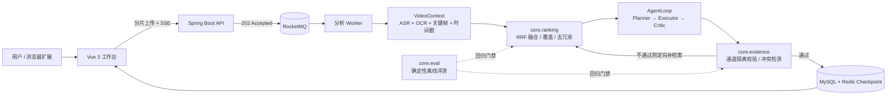

# SceneMind

> 面向长视频的**证据可核验** Video Agent 工作台。
> 把数小时的视频变成一条可检索、可回放、每条结论都能定位到原始时间戳的多模态证据链。

长视频理解和「把视频丢给模型总结一下」是两件不同的事：上传和分析都是分钟级任务，模型调用按 Token 计费，而最麻烦的是——模型很会编。SceneMind 围绕这三件事设计：把耗时链路异步化、把语音与画面融合成带时间戳的统一上下文、再用一层确定的校验规则约束模型输出。

---

## 它解决什么问题

| 难点 | SceneMind 的处理 |
| --- | --- |
| 大文件上传与解析都是长耗时任务 | 5MB 分片 + 断点续传，RocketMQ 削峰，提交即返回 202；Checkpoint 以 MySQL 为真源、Redis 为热缓存 |
| 外部调用贵且不稳定 | 用户级/全局令牌桶、有限次指数退避、向量库与 Embedding 故障优雅降级、AgentLoop 轮次上限 |
| 结论找不到依据 = 幻觉 | 每条结论必须绑定 `ASR` / `OCR` / `ASR+OCR` 来源与时间戳，由 Critic 闭环校验，不过关就定向补检索 |
| 证据散落在数小时里 | 时序多模态 `VideoContext` + 混合检索；**SceneMind 用 RRF 多通道融合替代线性加权**，解决跨时段覆盖与近重复问题 |

---

## 能力边界

一个项目值不值得聊，边界比功能列表更重要。SceneMind 明确**不**做：

- 不自研 ASR / OCR / Embedding 模型，全部通过可替换的外部服务接入；
- 不做模型训练与微调，Agent 的质量靠**检索策略 + 证据约束 + 离线评测**保障；
- 不做多租户、计费、公网级鉴权，部署目标是本地 / 单机可信环境；
- 不承诺「任意视频都能得到正确答案」：画面与语音冲突时会**显式标注冲突**，而不是替用户猜。

基础设施层（上传、消息队列、存储、鉴权、工作台）沿用一套成熟的 Java/Vue 实现；**SceneMind 的设计与实现集中在检索排序、证据校验和评测闭环这三块**，详见 `docs/PROJECT_OVERVIEW.md` 与 `docs/CONTRIBUTION_BOUNDARY.md`。

---

## 我主导的改造

### 1. 检索排序：从线性加权到 RRF 多通道融合

改造前把三个通道的原始分直接加权相加：`0.6 * semantic + 0.25 * lexical + 0.15 * visual`。问题很具体——`semantic` 可能是 Qdrant 返回的 `[0,1]` 分数，也可能是本地 cosine 的 `[-1,1]`，而 `lexical` / `visual` 是 `[0,1]` 的命中率。量纲不一致时，权重就不再代表真实重要性，换一家向量服务就能让排序悄悄漂掉。

我把排序层从 Spring Service 里抽出来，做成 `com.scenemind.core.ranking` 纯函数内核：

- 三个通道各自产出**有序列表**，融合只使用名次：`score(d) = Σ w_c / (k + rank_c(d))`（RRF）。原始分数永不进入同一个加法式，天然免疫量纲差异；
- 第一轮每个 5 分钟时间窗只取最优证据，避免数小时视频的 TopK 全挤在同一段；名额不足再按融合分补满；
- 时间相邻且文本 bigram 相似度超阈值的片段判为近重复并抑制；
- `TopKPolicy` 根据通道命中数和分数分布动态决定召回预算，弱证据扩召回、头部强主导时收缩省 Token；
- 每次检索输出**可解释诊断**：各通道名次、选中阶段、抑制数量、覆盖时间窗数。

参数全部收敛到 `scenemind.ranking.*` 配置项，A/B 调参不需要改代码发版。

### 2. 证据校验：从 boolean 到可解释的判定

改造前的 `supported()` 只返回 true/false，线上出现「Critic 反复重检索但始终不通过」时，无法区分是时间戳越界、模型改写了原文，还是编造了来源——所有失败都无差别重跑两轮，白烧 Token。

新的 `EvidenceAuditor`：

- 拒绝原因枚举化（`TIMESTAMP_OUT_OF_RANGE` / `CROSS_CHANNEL_SPLICE` / `UNKNOWN_SOURCE` …），并标注 `retryable`，让 Agent 知道该回去补检索还是直接判定幻觉；
- **通道隔离**：声明 `ASR+OCR` 时分别检查两条通道，要求证据在同一通道内完整出现。改造前把 ASR 与 OCR 文本直接拼接，模型从语音尾巴 + 画面开头拼出一句原文里不存在的话也会被当成有效证据；
- 拒绝时仍返回文本二元组覆盖率，用于区分「改写」和「编造」；
- `ConflictDetector` 显式识别音画冲突（口播「八月一日上线」/ PPT「8月3日」），把不确定性作为一等信号输出。

原有三个 public 方法语义完全不变，既有的 4 个回归测试无需修改即可通过。

### 3. 离线评测：可被 CI 卡住的确定性回放

改造前名为 `OfflineAgentEvaluationRunner` 的入口实际仍会调用真实 LLM，需要 API Key、结果不可复现，也没法进 CI。

SceneMind 把「检索策略」单独抽出来做确定性回放：固定合成数据集 + 固定算法，不启动 Spring、不连数据库/向量库、不调用任何模型，`javac` + `java` 就能跑。评测入口自带 8 条断言，失败以非零码退出；CI 里再校验提交的 `docs/benchmark-report.md` 与 CI 生成结果一致，算法改了却没更新指标就会直接卡住 PR。

### 4. 工程化收口

包名从占位符 `com.example` 规范为 `com.scenemind`；新增 `core` 纯函数层及其单测；CI 拆出独立的零依赖评测 job；补齐 6 份设计与求职文档；评测脚本跨平台可复现。

---

## 量化结果

`docs/benchmark-report.md` 由评测程序自动生成，可直接 `./scripts/run-benchmark.sh` 复现。
数据集是**可复现的合成压力数据集**（2 小时课程 / 28 个候选片段 / 4 个标注相关片段），用于策略回归，**不是线上真实流量**：

| 指标 | 线性加权（改造前） | RRF 融合（改造后） |
| --- | ---: | ---: |
| Recall@8 | 1.000 | 1.000 |
| 时间覆盖率 | 1.000 | 1.000 |
| 证据冗余率 ↓ | 0.143 | **0.000** |
| 量纲稳定性 ↑ | 0.500 | **1.000** |

> 量纲稳定性 = 把语义分数做 `37x + 5` 的单调变换（模拟向量服务打分尺度变化）后 TopK 集合的 Jaccard。RRF 只用名次，恒为 1.000；线性加权会因权重失衡漂移一半结果。
> Recall 与覆盖率在这份数据集上持平——相关片段信号较强，改造解决的是**冗余与鲁棒性**，不是召回上限。要验证召回收益需要真实标注集，这是路线图里的下一步。

测试：`server` 20 个测试类、0 失败（其中 26 个为本次新增）；`client` 与 `extension` 的既有测试保持通过。

---

## 架构



`core` 三个包不依赖 Spring、数据库或网络，可单独编译运行；`server` 只做 DTO 适配、外部依赖降级与埋点。

---

## 快速开始

环境：JDK 21、Node.js 22、Docker Compose v2、FFmpeg、Tesseract（含 `chi_sim` / `eng`）。

```bash
cp .env.example .env          # 填入数据库 / Redis / MinIO / Qdrant 密码与 SILICONFLOW_API_KEY
./scripts/dev-up.sh           # 启动中间件，默认只监听 127.0.0.1
cd server && ./mvnw spring-boot:run     # http://localhost:9090/health
cd client && npm ci && npm run dev      # http://localhost:5173
```

只复现评测（**不需要任何中间件或 API Key**）：

```bash
bash scripts/run-benchmark.sh          # 需要 JDK 21+，输出 docs/benchmark-report.md
cd server && ./mvnw test               # 后端全套单测
```

前端 `http://localhost:5173/?demo` 可用内置示例数据查看工作台，不依赖后端。

---

## 目录结构

```
SceneMind
├── server/src/main/java/com/scenemind/
│   ├── core/                  # 纯函数内核（零框架依赖）
│   │   ├── ranking/           # RRF 融合、时间窗覆盖、去冗余、自适应 TopK、基线
│   │   ├── evidence/          # 结构化证据校验、拒绝原因、音画冲突检测
│   │   └── eval/              # 确定性离线评测、指标、自检入口
│   └── server/                # Spring Boot：DTO 适配、编排、降级、埋点
├── client/                    # Vue 3 工作台
├── extension/                 # 浏览器侧面板
├── scripts/run-benchmark.sh   # 零依赖评测复现脚本
├── docs/
│   ├── PROJECT_OVERVIEW.md        # 项目说明
│   ├── CONTRIBUTION_BOUNDARY.md   # 变更清单与贡献边界
│   ├── RESUME.md                  # 简历成果描述
│   ├── INTERVIEW_TOPICS.md        # 面试技术话题
│   ├── benchmark-report.md        # 自动生成的评测报告
│   └── adr/                       # 架构决策记录
└── .github/workflows/ci.yml
```

---

## 路线图

- [ ] 接入真实标注视频集，验证召回收益而不只验证鲁棒性
- [ ] 用评测报告驱动 RRF 参数自动寻优（`k` 与通道权重）
- [ ] 把 `retryable` 拒绝原因接进 AgentLoop，按原因选择重试策略
- [ ] 检索诊断落到前端调试面板，支持一次分析任务的完整 trace 回放

---

## License & Acknowledgements

MIT License，详见 [LICENSE](LICENSE)。第三方依赖与来源说明见 [NOTICE.md](NOTICE.md)。
