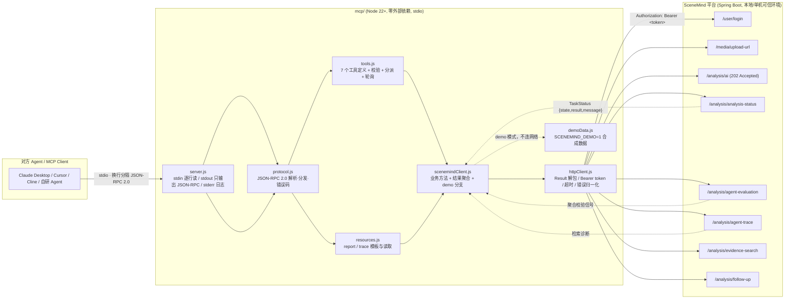

# SceneMind MCP Server 设计说明

> 配套实现见 `mcp/`。本文说明**为什么**把它做成 MCP、系统架构、能力清单、传输取舍，以及最关键的：当分析结果返回给「对方的 Agent」时，证据与时间戳如何被保留下来而不退化成一段无凭无据的总结。

---

## 1. 为什么做成 MCP —— Agent-to-Agent 的能力出口

SceneMind 本身是一个面向长视频的「证据可核验」工作台：Vue 前端 + Spring Boot 后端 + 浏览器扩展，面向**人**操作。但它的核心价值（把数小时视频变成一条可检索、可回放、每条结论都能定位到原始时间戳的多模态证据链）同样适合被**另一个 Agent** 当作一项能力来调用：

- 对方的 Agent（Claude Desktop / Cursor / Cline / 自研 Agent）在对话里说「帮我看这个两小时的发布会视频，确认上线日期」，它自己没有 ASR/OCR/向量检索/证据校验这一整套基础设施；
- SceneMind 平台恰好把这套链路做成了分钟级异步任务；
- 中间缺的就是一个**标准的、可发现的能力出口**：让外部 Agent 知道「有哪些工具、参数怎么填、结果长什么样、去哪拿诊断」。

MCP（Model Context Protocol）就是这层出口：它用 `tools/list` 暴露能力、用 `tools/call` 调用、用 `resources/read` 取回大块产物，且是模型无关的标准协议。于是链路变成：

```
对方 Agent  ──MCP──▶  SceneMind MCP Server  ──REST──▶  SceneMind 平台  ──▶  带时间戳证据的结构化结果  ──MCP──▶  对方 Agent
```

**边界**：MCP Server 是薄的适配层，不重复实现任何分析算法、不重新做证据校验；它只做协议转换、参数校验、Result 信封解包、鉴权注入，以及把平台分散在多个端点的信息**聚合**成一份对 Agent 友好的结果。平台仍是唯一的真源。

---

## 2. 架构



文本版分层：

```
Agent ↔ stdio JSON-RPC 2.0 ↔ server.js
                              ├─ protocol.js        (无 I/O 的纯函数)
                              ├─ tools.js           (能力定义/校验/等待)
                              ├─ resources.js       (模板化 URI)
                              └─ scenemindClient.js (业务 + 聚合 + demo)
                                     └─ httpClient.js (信封/token/超时) ↔ 平台 REST
```

关键设计点：

- **零外部依赖**：只用 Node 内置模块，便于审计、离线安装、进 CI。
- **真接口映射**：每个方法都对应代码里真实存在的控制器端点，不臆造。`/media/upload-url` 收 `url`（form），`/analysis/ai` 收 `?id&goal&mode`，其余状态/评测/trace/检索/追问都按 `AnalysisController` / `MediaController` / `UserController` 的真实签名。
- **Result 信封统一解包**：平台约定 `{code, message, data}`，`code === 0` 成功；HTTP 状态只表达传输语义（202 受理 / 200 已有结果）。`httpClient.js` 把这层收敛掉，并保留 `status` 以区分 202/200。
- **鉴权**：`AuthInterceptor` 要求 `Authorization: Bearer <token>`；token 来自 `SCENEMIND_TOKEN`，或由 `SCENEMIND_EMAIL`/`SCENEMIND_PASSWORD` 惰性登录 `POST /user/login` 换取。

---

## 3. 工具与资源清单

### Tools（7 个，前缀 `scenemind_`）

| 工具 | 作用 | 是否等待完成 |
| --- | --- | --- |
| `scenemind_submit_video` | 提交在线视频 URL 入库，返回 `mediaId` | 否 |
| `scenemind_analyze` | 触发 `POST /analysis/ai` 分析 | 否（202 受理即返回） |
| `scenemind_get_result` | 聚合状态/评测/trace，返回结构化结果 | **否**（未完成只回当前状态与阶段） |
| `scenemind_wait_for_result` | 超时内轮询直到完成或超时 | 是（默认 180s、上限 600s，超时明确标注未完成） |
| `scenemind_search_evidence` | 带时间戳的证据命中片段 | 否 |
| `scenemind_ask_followup` | 基于已有结果的追问 | 否 |
| `scenemind_verify_evidence` | 逐条证据「是否可核验」的判定说明 | 否 |

典型调用链：`submit_video → analyze → wait_for_result（或 get_result）→ 可选 search_evidence / ask_followup / verify_evidence`。

`get_result` / `wait_for_result` 共享同一个结构化结果对象，字段包括：`state`、`completed`、`failed`、`message`、`markdown`、`evidence[]`（时间戳/来源/原文）、`conflicts[]`、`conflictFlagged`、`evidenceAudit`、`trace`（URI + traceId + 提示）、`hint`。

### Resources

| URI 模板 | 内容 | mimeType |
| --- | --- | --- |
| `scenemind://task/{mediaId}/report` | 分析报告 markdown | `text/markdown` |
| `scenemind://task/{mediaId}/trace` | 检索诊断 JSON | `application/json` |

二者是模板（按 `mediaId` 参数化），列在 `resources/list` 的 `resourceTemplates`（同时镜像到 `resources` 便于各类客户端发现）。`resources/read` 负责 URI 解析、可选 `?goal=&mode=` 任务定位、以及错误返回（格式错误 `-32602`、未知类型 `-32002`）。

### 已实现的 MCP 方法

`initialize`、`notifications/initialized`、`tools/list`、`tools/call`、`resources/list`、`resources/read`、`ping`。错误码覆盖 `-32700` / `-32600` / `-32601` / `-32602` / `-32603`。

---

## 4. 传输：stdio 与 Streamable HTTP

两种传输共用同一套 `handlers / tools / resources`：

| 维度 | stdio | Streamable HTTP |
| --- | --- | --- |
| 启动 | MCP 客户端本地拉起 `node src/server.js` | 常驻 `node src/httpServer.js`，默认监听 `127.0.0.1:8090` |
| 端点 | stdin/stdout 换行分隔 JSON-RPC | `POST /mcp`（JSON-RPC，响应 `application/json`）；`GET /health` |
| 认证 | 继承本地环境变量 | **必须**配置 `SCENEMIND_MCP_TOKEN`，请求带 `Authorization: Bearer <token>` |
| 适用 | 个人桌面 Agent、离线演示、CI | 跨机器 / 多 Agent 共享 |

远程部署建议：

1. MCP Server 只监听 `127.0.0.1`，由 Nginx/Caddy 反代 `/mcp` 并启用 TLS；
2. `SCENEMIND_MCP_TOKEN` 只放服务端环境变量（root-only），不要写进客户端配置；
3. 平台侧目前仍是单用户、无多租户隔离，公网实例建议再套一层 Basic Auth / VPN / IP 白名单；
4. `GET /mcp`（服务端推送 SSE）尚未实现；当前是无状态请求-响应模型，长任务由 `wait_for_result` 轮询。

---

## 5. 用 `SCENEMIND_DEMO=1` 演示

demo 模式**完全不连后端**，返回 `mcp/src/demoData.js` 的内置合成数据，适合离线演示、CI、以及在没有 JDK / 中间件 / API Key 的机器上验证完整链路。

```bash
# 1) 跑全套测试（内置假 HTTP 服务 + demo，无需真实后端）
cd mcp && node --test test/*.test.js

# 2) 手工一行 initialize，立刻拿到合法 JSON-RPC 响应
printf '%s\n' '{"jsonrpc":"2.0","id":1,"method":"initialize","params":{"protocolVersion":"2024-11-05"}}' \
  | SCENEMIND_DEMO=1 node mcp/src/server.js

# 3) 在 Claude Desktop / Cursor 里配置（见 mcp/README.md），env 里加 "SCENEMIND_DEMO": "1"
#    然后让 Agent 走：submit_video → analyze → get_result / verify_evidence
```

demo 内置一条与 `docs/benchmark-report.md` 一致的音画冲突：口播「**8月1日**上线」/ 画面 OCR「**8月3日**」，并在示例中附带结构化的 `conflicts` 与 `evidenceAudit`，用来演示「平台若提供结构化信号就直接使用」的路径。

> 结构化信号现状：本次改造后，平台已把这些信号做成一等输出——
> `/analysis/analysis-status` 的 `TaskStatus` 带 `conflicts`（含时间戳、ASR/OCR 值、说明）；
> `/analysis/agent-trace` 顶层带 `conflicts` 与 `evidenceAudit`，`diagnostics` 里另有 `retrieval` / `evidence` / `retry` 三块；
> `/analysis/agent-evaluation` 带 `evidenceAudit`（`total` / `accepted` / `retryableRejections` / `hallucinationRejections` / `findings` / `notes`）。
> MCP 客户端优先采用这些结构化字段（`conflictsOrigin` / `evidenceAuditOrigin` 会标 `platform-structured`）；
> 只有对接旧版本后端时才回退到 `conflictFlagged` 等聚合信号或从 markdown 报告解析证据。
> `verify_evidence` 仍然不重新实现校验：它把平台 `EvidenceAuditor` / `Critic` / `ConflictDetector` 的逐条判定转述给调用方。

---

## 6. 结果返回给对方 Agent 时，证据与时间戳如何保留

这是整个 MCP 层最需要克制的地方：长视频分析的结论最容易被「总结成一段话」而丢掉依据。本实现用三层来保留证据与时间戳：

### 6.1 不改写平台的原始产物

平台 `TaskStatus.result` 里的 markdown 报告由 `AnalysisResult.toMarkdown()` 生成，内含形如

```
- [08:42] ASR：新功能将于八月一日正式上线，敬请期待。
- [08:45] OCR：上线时间：8月3日
```

的**时间戳 / 来源 / 原文**三元组。`get_result` 把这份 markdown **原样**放进结果对象的 `markdown` 字段，不重写、不摘要；`scenemind://task/{mediaId}/report` 资源也直接返回它。Agent 拿到的第一手材料就是带时间戳的证据链。

### 6.2 额外给出结构化证据列表，并标注来源

为了让程序化消费（而非人读 markdown）也能拿到时间戳，结果对象另带 `evidence[]`，每项含 `timestampLabel`（如 `[08:42]`）、`timestampMs`、`source`、`content`。其来源被显式标注在 `evidenceOrigin`：

- 若平台在状态/评测里直接给了结构化 `evidence`，用 `platform-structured`；
- 否则从上面的 markdown `## 视频证据` 段落解析，标 `parsed-from-markdown-report`。

也就是说，**解析自平台自己的报告，而不是客户端凭空生成证据**；`timestampMs` 由报告里的 `mm:ss` 还原，并同时保留原始 `timestampLabel` 文本，避免精度信息被悄悄丢弃。

同理，`search_evidence` 返回的命中片段保留 `startMs` / `endMs` 与可读时间戳文本；`ask_followup` 的答案里也带时间戳引用。

### 6.3 核验信号与诊断「转述」，不伪造

- **音画冲突**：`conflicts` / `conflictFlagged` 来自平台 `conflictFlagged` 或结构化 `conflicts`，标 `conflictsOrigin`；平台不替用户猜日期，只显式标注冲突，MCP 层照搬。
- **证据核验摘要**：优先采用 `agent-evaluation` / `agent-trace` 里的结构化 `evidenceAudit`（逐条 `findings`：时间戳、通道、`accepted`、`reason`、`retryable`、`similarity`），标 `evidenceAuditOrigin: platform-structured`；旧后端缺失该字段时，回退到 `evidenceSupportRate`、`timestampCoverageRate`、`criticPassed` 等聚合信号并标 `platform-signals`。无论哪条路径，都附上「这是平台服务端 EvidenceAuditor / Critic / ConflictDetector 的输出，不是客户端重校验」的说明。
- **`scenemind_verify_evidence`**：明确声明它**不重新实现一套伪校验**——客户端不持有 `VideoContext` 原始语料，无法对每条证据独立做逐字 / 逐通道 / 时间戳越界的重验。它只把平台已有的校验信号转述给 Agent；若平台提供了结构化 `evidenceAudit`，则直接采用其中的逐条 `verdict`。
- **trace 指针**：结果里始终带 `trace.uri`（`scenemind://task/{mediaId}/trace`）与 `traceId`，Agent 需要时可读取检索诊断 JSON（通道名次、覆盖时间窗、Token / 成本），把「结论 → 证据 → 检索过程」串成可回放的链。

### 6.4 一句话总结

> 返回给对方 Agent 的不是「视频说了 X」，而是「在 `08:42` 的 `ASR` 里原文是 A、在 `08:45` 的 `OCR` 里原文是 B，二者冲突且平台已标注；核验信号来自平台服务端，完整检索诊断在 trace 资源里」。时间戳、来源、原文三者在 markdown、结构化 `evidence[]`、以及 `search_evidence` 命中里被重复保留，且每一处都标明了它来自平台还是由平台报告解析而来。

---

## 7. 验证状态与依赖真实后端才能验证的部分

- `cd mcp && node --test test/*.test.js`：52 个测试全绿。`server.test.js` 用 `node:http` 起本地假 SceneMind 服务并拉起子进程跑完整 `tools/call`；`httpServer.test.js` 验证 Streamable HTTP 的鉴权、`tools/list`、通知 202 与健康检查；`demo.test.js` 验证离线 demo；`protocol.test.js` 验证纯函数与错误码。
- **依赖真实后端才能验证**（当前只能用假服务验证协议与数据形状，不能验证真实业务语义）：真实 Spring Boot 的 token 会话、异步 202 到 `COMPLETED` 的真实耗时与阶段流转、真实 ASR/OCR 产出的证据与时间戳、`ConflictDetector` 的真实冲突判定、`agent-evaluation` 的真实指标数值、以及 `follow-up` / `evidence-search` 的真实模型回答。这些需要启动 `server/` 及其中间件（见仓库 `README.md` 快速开始）后联调。
